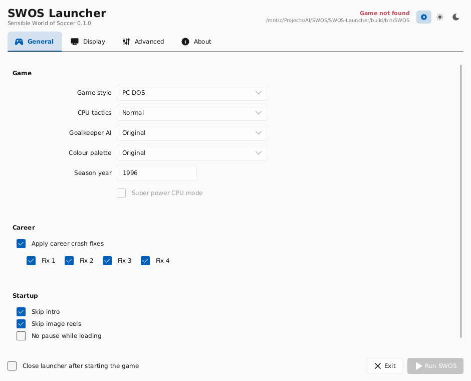

# SWOS Launcher

A cross-platform C++ port of the Delphi **SWOS 2020 Game Launcher**, built on
SDL2, OpenGL 3.3 core and [Slint](https://slint.dev). Targets Windows, macOS and
Linux, and is intended to fold into
[SWOS-United](https://github.com/benbaker76/SWOS-United) once it settles.



## What it does today

* Reads and writes `ini/gameLauncher.ini` with the **exact** sections, keys and
  defaults the Delphi launcher used, so an existing install keeps working.
* Builds the game's command line (a flag-for-flag port of `getCLI`) and launches
  it, waiting for it to exit.
* Rewrites the game's `swos.ini` `[video]` section before launching.
* Enumerates real display modes from SDL, so every resolution the monitor
  supports is offered — not just the hard-coded list the Delphi build shipped.
* Windowed, borderless-fullscreen and exclusive-fullscreen, with Alt+Enter to
  toggle and a 100%–200% interface scale.
* Light / dark themes, defaulting to the desktop setting.

See [docs/PORTING.md](docs/PORTING.md) for what is not ported yet — chiefly the
DLC and team-database tabs.

## Build

```bash
./scripts/fetch_slint.sh          # scripts\fetch_slint.ps1 on Windows
cmake -S . -B build -G Ninja -DCMAKE_BUILD_TYPE=Release
cmake --build build
```

Full per-platform instructions, including building Slint from source, are in
[docs/BUILDING.md](docs/BUILDING.md).

## Run

```
swos-launcher [options]

  --fullscreen[=desktop|exclusive]  start full screen (default: desktop)
  --windowed                        start windowed (overrides the saved setting)
  --display=N                       open on monitor N (0 = primary)
  --scale=F                         interface scale, e.g. 1.25
  --help
```

The launcher looks for the game in `swos-path.txt` next to the executable, or in
`./SWOS` if that file is absent.

## Layout

```
include/, src/     application code
  window.*           SDL2 window + GL 3.3 core context (ported from SWOS-United)
  slint_gl_platform.*  Slint custom platform -> software render -> GL texture
  settings.*         the Delphi TSetting record and its ini format
  game_launch.*      command-line construction and process spawn
  system_theme.*     desktop light/dark detection
ui/launcher.slint  the interface
assets/icons/      Tabler icons (MIT), vendored
docs/              architecture, porting and build notes
```

## Licence

The Slint runtime is used under its royalty-free desktop licence; see
`third_party/slint/licenses` after fetching. Icons are
[Tabler Icons](https://tabler.io/icons) (MIT).
