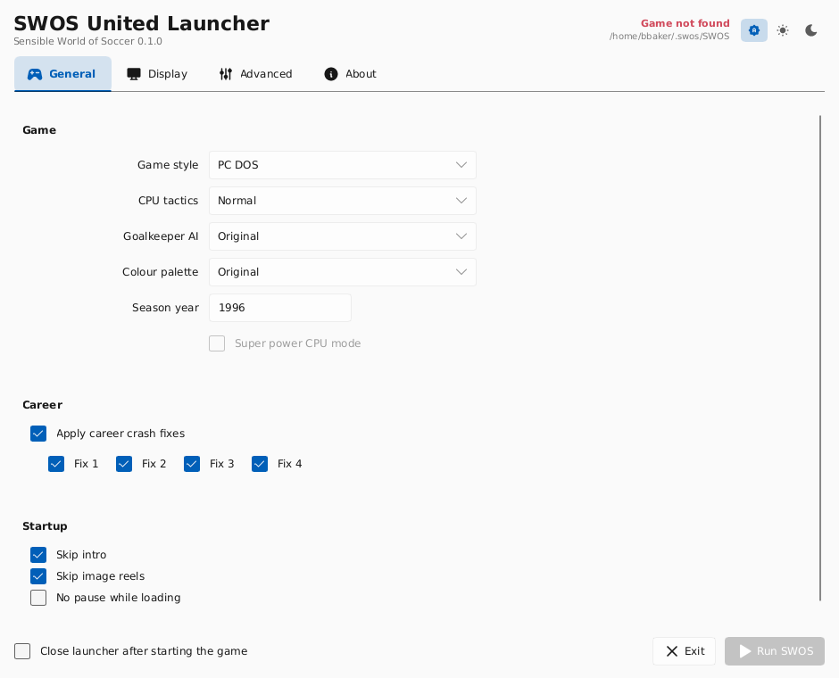
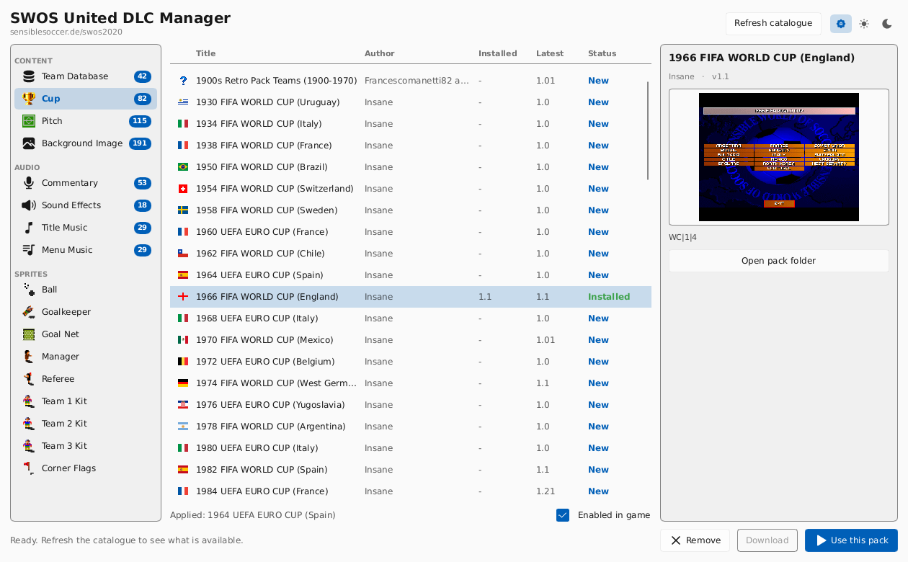
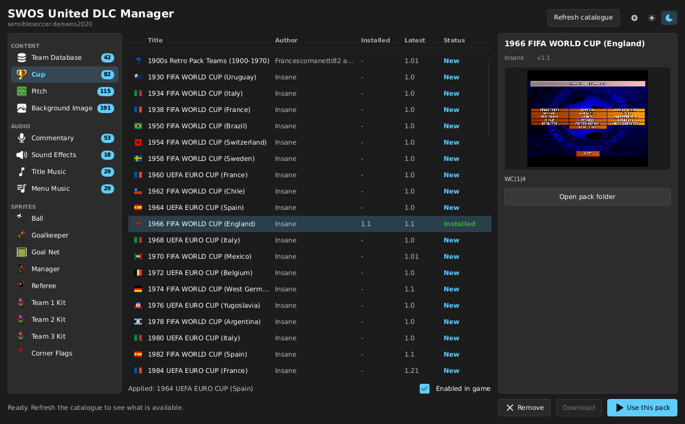

# SWOS Tools

A cross-platform C++ port of the Delphi **SWOS 2020** suite, built on SDL2,
OpenGL 3.3 core and [Slint](https://slint.dev). Targets Windows, macOS and
Linux, and is intended to fold into
[SWOS-United](https://github.com/benbaker76/SWOS-United) once it settles.

| binary | name | replaces | what it does |
|---|---|---|---|
| `swos-launcher` | SWOS United Launcher | `gameLauncher.dpr` | game settings and launching |
| `swos-dlc-manager` | SWOS United DLC Manager | `DLCManager.dpr` | browse, download and install DLC |

Both share `swos-core` and the same `ini/gameLauncher.ini`, so a pack selected
in the manager is the pack the launcher applies.



## The launcher

* Reads and writes `ini/gameLauncher.ini` with the **exact** sections, keys and
  defaults the Delphi launcher used, so an existing install keeps working.
* Builds the game's command line (a flag-for-flag port of `getCLI`) and launches
  it, waiting for it to exit.
* Rewrites the game's `swos.ini` `[video]` section before launching.
* Enumerates real display modes from SDL, so every resolution the monitor
  supports is offered — not just the hard-coded list the Delphi build shipped.
* Windowed, borderless-fullscreen and exclusive-fullscreen, with Alt+Enter to
  toggle and a 100%–200% interface scale.
* Light / dark themes, defaulting to the desktop setting.

## The DLC manager



<sub>Light and dark follow the desktop by default.</sub>



* Fetches all 17 DLC catalogues from `sensiblesoccer.de/swos2020`, merging them
  with what is installed to mark each pack New / Update / Installed / Removed.
* Downloads and extracts `.7z` packs in-process (libcurl + libarchive), on a
  worker thread so the UI keeps painting, with progress and cancel.
* Image previews for pitches, cups, sprites and backgrounds; audio previews for
  commentary, sound effects and music. The artwork comes from the pack's own
  `_preview` archive, fetched alongside it.
* Country flags in the Commentary and Cup lists, from the original's own icons.
* Records the selection the launcher then applies.

### SWOS United mods

With a mod index configured (`[DLC] modIndexUrl` in `ini/gameLauncher.ini`, or
`$SWOS_MOD_INDEX` for one run; `file://` works for testing) the manager lists
SWOS United's mods instead of SWOS 2020's packs. The index is OpenSWOS's
`index.json` (its `docs/MODS.md` §10.1). Each mod is downloaded as a zip,
checked against the index's sha256, and unpacked into the user folder's `mods/`.
**Turn on** adds it to `SWOS.ini`'s `[mods] enabled`, turns off the other mods of
its slot (one pitch, one commentary, …), and makes the setting the game needs
to use it: `[graphics] style = 2020` for a pitch, `[audio] style = pc` for
commentary and effects, `[audio] music = pc` for music (menu music also sets
`menu_music = mp3`).

`scripts/dlc2020_to_mods.py` turns SWOS 2020's server packs into those mods and
writes the index. Each mod's uuid and folder name are kept in
`scripts/dlc2020_uuids.json`, so commit it after a conversion.

See [docs/PORTING.md](docs/PORTING.md) for what is not ported yet — chiefly
applying an installed pack to the game directory, and the cup/DIY editor.

## Build

```bash
./scripts/fetch_slint.sh          # scripts\fetch_slint.ps1 on Windows
cmake -S . -B build -G Ninja -DCMAKE_BUILD_TYPE=Release
cmake --build build
```

Full per-platform instructions, including building Slint from source, are in
[docs/BUILDING.md](docs/BUILDING.md).

## Run

```
swos-launcher [options]

  --fullscreen[=desktop|exclusive]  start full screen (default: desktop)
  --windowed                        start windowed (overrides the saved setting)
  --display=N                       open on monitor N (0 = primary)
  --scale=F                         interface scale, e.g. 1.25
  --help
```

The launcher looks for the game in `swos-path.txt` next to the executable, or in
`./SWOS` if that file is absent.

## Where your files live

Settings and downloaded DLC go in the per-user SWOS folder, the same one
SWOS-United uses, so the game and these tools agree:

| | |
|---|---|
| Windows | `%USERPROFILE%\Documents\SWOS` |
| macOS | `~/Library/Application Support/SWOS` |
| Linux | `~/.swos` |

Inside it, `ini/`, `dlc/` and `temp/` keep the names the Delphi build used.

## Layout

```
core/                shared library
  window.*             SDL2 window + GL 3.3 core context (ported from SWOS-United)
  slint_gl_platform.*  Slint custom platform -> software render -> GL texture
  settings.*           the Delphi TSetting record and its ini format
  game_launch.*        command-line construction and process spawn
  dlc_catalog.*        the DLC model, shared by both apps
  mod_store.*          SWOS United mods: the index, mods/, SWOS.ini [mods]
  json.*, sha256.*     small readers for the index and download checks
  http.*               libcurl downloads, sync and async
  archive_extract.*    libarchive 7z extraction
  system_theme.*       desktop light/dark detection
apps/launcher/       swos-launcher + launcher.slint
apps/dlc_manager/    swos-dlc-manager + dlc_manager.slint + audio preview
assets/icons/        Tabler icons (MIT), vendored
docs/                architecture, porting and build notes
```

## Licence

The Slint runtime is used under its royalty-free desktop licence; see
`third_party/slint/licenses` after fetching. Icons are
[Tabler Icons](https://tabler.io/icons) (MIT).
